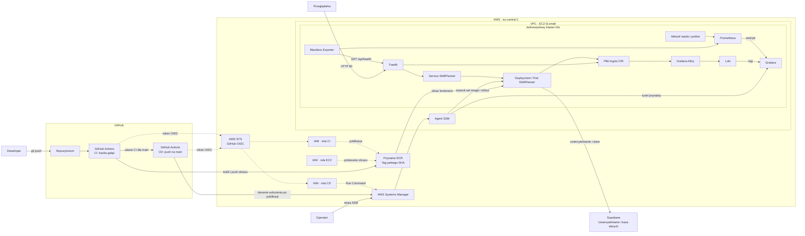

# Architektura ShiftPlanner

Rola CI publikuje obraz w ECR. Po jego publikacji rola CD zleca polecenie SSM na docelowej instancji. Agent wykonuje lokalnie `k3s kubectl set image` oraz sprawdza rollout. Obraz pobiera węzeł z ECR przez dostawcę poświadczeń kubeleta, korzystającego z roli EC2. Polecenie SSM przenosi identyfikator obrazu, a dane obrazu płyną bezpośrednio z ECR do węzła. [Uprawnienia OIDC](../infra/github_oidc.tf), [Pobieranie obrazu](KUBERNETES.md#dostęp-administracyjny-i-pobieranie-obrazu)

Ruch użytkowników trafia przez publiczny port 80 do Traefika i dalej do usługi aplikacji. Supabase działa poza granicą AWS projektu. Operator otwiera tunel SSM do wewnętrznej usługi Grafana. Prometheus i Loki udostępniają dane Grafanie w obrębie klastra. [Monitoring](MONITORING.md), [Centralne logowanie](LOGGING.md)

Środowisko demonstracyjne korzysta z jednej instancji `t3.small` i jednej repliki aplikacji. Restart lub wymiana węzła może przerwać dostęp. Dane Prometheusa i Loki korzystają z lokalnych wolumenów efemerycznych. Odtworzenie środowiska i usunięcie jego zasobów opisano osobno. [Odtworzenie](DEPLOYMENT.md), [Sprzątanie](CLEANUP.md)
